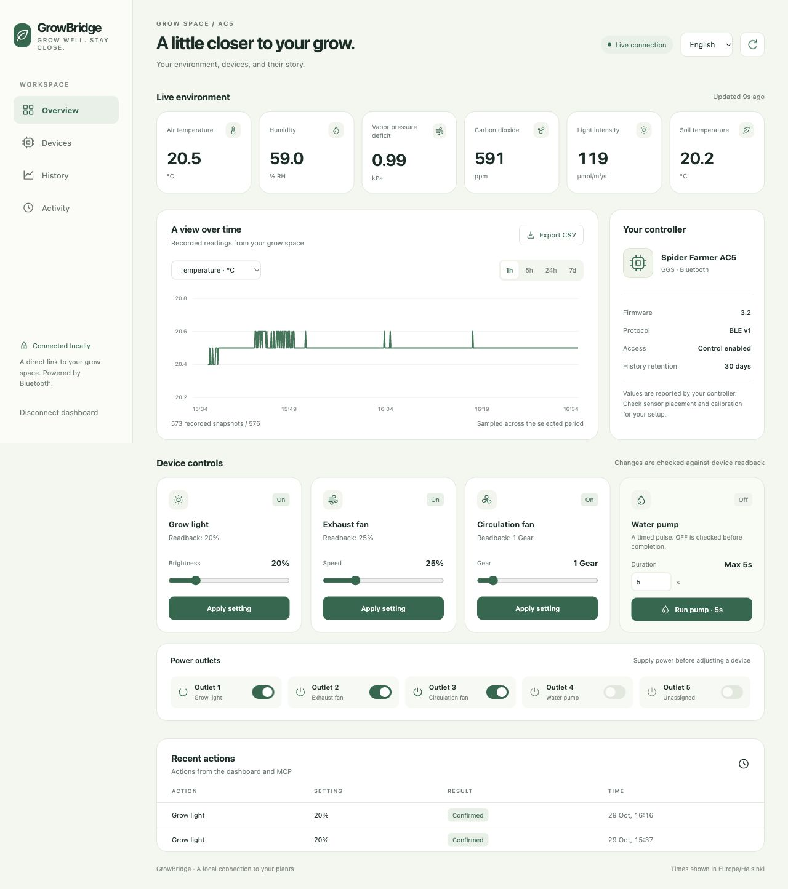
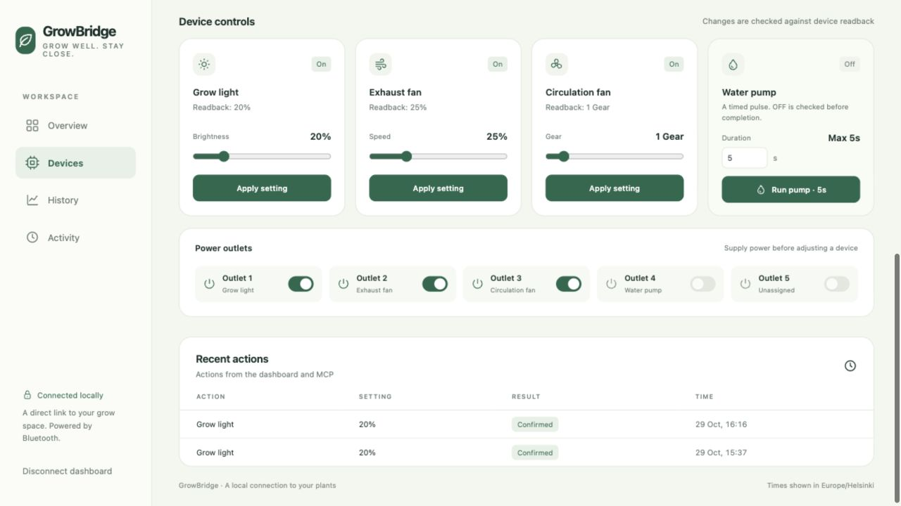
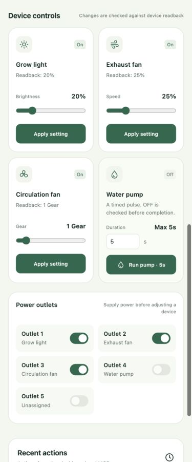

# Spider Farmer GrowBridge

English | [简体中文](README.zh-CN.md)

Connect to Spider Farmer GGS controllers over local Bluetooth and give LLMs tools for environmental monitoring, historical data, outlet switching, light and fan control, and timed pump operation.

This is an independent, early-stage project with no affiliation with Spider Farmer. Protocol reads, outlet switching, dimming, and speed control have been verified on **macOS with an AC5 advertising as SF-GGS-PS5, firmware 3.2, using plaintext protocol v1**. A Linux/Raspberry Pi backend and installation scripts are included; Bluetooth operation on a physical Raspberry Pi has not yet been verified. Encrypted v2 firmware is detected and control is rejected.

## Preview

Screenshots captured from a real AC5 connected over local Bluetooth on macOS. Readings, history, and device states reflect the time of capture.

**Desktop overview** — environment readings, historical trends, controls, and recent actions.



<details>
<summary>Device controls and mobile layout</summary>

**Device controls** — light brightness, fan speeds, timed pump operation, and power outlets.



**Mobile layout** — the same controls on a narrow screen.



</details>

## How it works

```text
LLM / Codex
   │ MCP stdio (local or over SSH)
   ▼
GrowBridge MCP client
   │ Authenticated local HTTP
   ▼
GrowBridge daemon ─── SQLite history and operation records
   │ Single Bluetooth connection
   ▼
Spider Farmer AC5 / GGS
```

The daemon owns the Bluetooth connection, executes commands, verifies device readback, and records history. MCP clients access it through the local API, which listens only on `127.0.0.1:8766` by default. Each installation generates a separate access token. Clients read the token from private configuration, so it stays out of MCP configuration files.

This release supports on-demand control, continuous data collection, and a local web dashboard. Unattended environmental optimization, irrigation schedules, MQTT, and cloud models are outside its current scope.

## Installation

Requires Python 3.11+. macOS also requires Xcode Command Line Tools; Linux requires BlueZ and the system D-Bus.

```sh
git clone https://github.com/kirinhcl/spiderfarmer-growbridge.git
cd spiderfarmer-growbridge
python3 -m venv .venv
.venv/bin/python -m pip install -c constraints-tested.txt .
.venv/bin/growbridge scan
```

On first use, macOS compiles and launches the native `GrowBridge BLE` helper. Allow it to use Bluetooth when prompted. The scan lists device addresses usable on that machine. Use the scanned address in the following command:

```sh
.venv/bin/growbridge init --device YOUR_SCANNED_ADDRESS
.venv/bin/growbridge serve
```

Open another terminal to check the current state:

```sh
.venv/bin/growbridge status
```

Control is disabled by default. After checking your wiring, set `controls_enabled = true` in the private configuration at `~/.config/spiderfarmer-growbridge/config.toml`, then restart the service. You can also enable control explicitly during initial setup with `init --device YOUR_SCANNED_ADDRESS --enable-controls`.

The default outlet mapping is shown below. Update the configuration first if your wiring differs.

| Device | Outlet | Control range |
| --- | --- | --- |
| Grow light | 1 | Brightness 0–100%; 0 turns it off |
| Exhaust fan | 2 | Speed 0–100%; 0 turns it off |
| Circulation fan | 3 | Gears 0–10; 0 turns it off |
| Water pump | 4 | Finite pulses; default maximum 5 seconds, with a 60-second cooldown |

Dimming and speed commands do not automatically switch on the corresponding power outlet. Turn on the correctly wired outlet before adjusting a device. Outlet 5 has no default assignment; writes to outlets absent from the live configuration are rejected.

## Local dashboard

With the daemon running, open the dashboard from the same installation:

```sh
.venv/bin/growbridge dashboard
```

The browser shows live temperature, humidity, VPD, CO₂, PPFD and soil temperature; device readbacks; light and fan controls; power outlets; and finite pump pulses. Historical charts cover 1 hour, 6 hours, 24 hours or 7 days. Choose a measurement, inspect individual recorded points, or export all raw samples in the chosen period as CSV. Recent actions include both dashboard and MCP requests. The responsive interface defaults to English and supports Simplified Chinese.

Opening the dashboard uses a single-use link that expires after 60 seconds. The browser receives an HttpOnly session cookie valid for 12 hours; the installation's API token is never sent to browser JavaScript. Use `Disconnect dashboard` to revoke that session. After the daemon restarts or the browser session expires, run the command again. Manual controls use the same validation and readback checks as MCP. Stale data or a read-only installation disables controls.

Charts select actual snapshots across the full requested window when there are many samples. They show gaps in collection and do not invent missing readings. CSV exports include every recorded sample in the window, with UTC timestamps; charts use the browser's local timezone. A missing reading is shown as a dash, while a reported zero remains zero.

The dashboard runs entirely from local assets and requires no frontend build or CDN. The service still listens only on loopback. On a Raspberry Pi, forward the port over SSH before opening it on your Mac:

```sh
ssh -L 8766:127.0.0.1:8766 YOUR_PI_HOST
```

In another terminal, request a short-lived connection link from the Pi:

```sh
ssh -T YOUR_PI_HOST /absolute/path/on/pi/spiderfarmer-growbridge/.venv/bin/growbridge dashboard --no-open
```

Open the returned link on the Mac within 60 seconds. Keep the SSH forwarding session running. This does not make the control interface public.

## Connect Codex or another MCP client

Keep the daemon running. Add a stdio server to your MCP client. For Codex, use:

```toml
[mcp_servers.growbridge]
command = "/absolute/path/spiderfarmer-growbridge/.venv/bin/growbridge"
args = ["mcp"]
```

Replace `/absolute/path` with your actual installation path. Available tools:

| Tool | Purpose |
| --- | --- |
| `get_health` | Bluetooth availability, data freshness, protocol, and outlet mapping |
| `get_status` | Environmental readings, outlet states, and device states |
| `get_history` | Existing observations from up to the last 168 hours; returns the latest 500 samples by default |
| `set_light` | Adjust grow light brightness |
| `set_exhaust` | Adjust exhaust fan speed |
| `set_fan` | Adjust circulation fan gear |
| `set_outlet` | Switch a power outlet; direct pump outlet activation is blocked |
| `run_pump` | Run a finite pump pulse and confirm OFF through device readback before returning |

Every control tool requires a `request_id`: 8–100 letters, digits, underscores, or hyphens. Use a new ID for each intended action and reuse that ID when retrying the same action to prevent duplicate execution. An ID cannot be reused with different arguments. After an operation fails, inspect the current state before deciding whether to submit a new action.

Example requests: “Check the current environment and tell me how old the readings are,” “Set the light to 25% and confirm the readback,” or “Retry the previous action with the same request ID; its outcome is unclear.”

## Run in the background on macOS

From the project directory, run:

```sh
.venv/bin/python scripts/install_macos.py
```

The installer creates a LaunchAgent for the current user and starts the service without changing device settings. It starts automatically at login. Data collection cannot continue while the Mac is asleep or the user is logged out. A Raspberry Pi is the intended deployment target for continuous operation. Logs are stored in the private data directory.

To stop the service and remove automatic startup:

```sh
.venv/bin/python scripts/install_macos.py --uninstall
```

## Deploy on Raspberry Pi

Enable SSH and connect to the network on Raspberry Pi OS Lite 64-bit, then run:

```sh
sudo apt update
sudo apt install -y python3-venv bluez dbus git
git clone https://github.com/kirinhcl/spiderfarmer-growbridge.git
cd spiderfarmer-growbridge
python3 -m venv .venv
.venv/bin/python -m pip install -c constraints-tested.txt .
.venv/bin/growbridge scan
.venv/bin/growbridge init --device YOUR_PI_SCANNED_ADDRESS
.venv/bin/growbridge serve
```

Verify read access before explicitly enabling control. A macOS device UUID cannot be used on Linux; scan again on the Raspberry Pi and save the address returned there.

To install the background service:

```sh
.venv/bin/python scripts/install_linux.py
systemctl --user status growbridge
```

To keep the user service running after SSH logout and start it at boot, an administrator must also enable linger for the target account: `sudo loginctl enable-linger "$USER"`. BlueZ/D-Bus permissions depend on the distribution and may require authorization for that account. The application does not require running as root.

To use the Raspberry Pi's MCP server from a Mac over SSH:

```toml
[mcp_servers.growbridge]
command = "ssh"
args = ["-T", "YOUR_PI_HOST", "/absolute/path/on/pi/spiderfarmer-growbridge/.venv/bin/growbridge", "mcp"]
```

Configure SSH keys and verify the host's identity first. Closing an MCP connection leaves the Raspberry Pi daemon running. The API continues to listen only on the Pi's loopback address; no public HTTP port is needed.

## Data and control boundaries

- Sensor samples are retained for 30 days by default, configurable through `retention_days`. History starts when the installed service begins collecting data.
- Configuration, SQLite data, and logs are stored in private user directories. The repository contains no actual device addresses, account identifiers, raw protocol captures, or device configuration backups.
- The service reads the target module's complete configuration before changing its fields. A successful acknowledgement is followed by a device-state readback to confirm the change.
- Ordinary controls are rejected when data is stale, Bluetooth is disconnected, or the protocol is unsupported. Reconnection does not replay historical commands.
- The daemon owns pump timing. A client disconnect does not cancel the OFF action. Operations are persisted before execution; after an interrupted pump operation, reconnection prioritizes turning the pump off rather than replaying ON.
- If pump shutdown cannot be confirmed, the service reports the fault, blocks further ordinary controls, and attempts to turn it off after restoring the connection. Software timing cannot guarantee shutdown during host power loss, forced process termination, or complete Bluetooth failure. Unattended irrigation needs device-side timing or independent hardware protection.
- Validation covers the specified device and protocol. Compatibility with other hardware and firmware remains unverified.

## Development and validation

```sh
.venv/bin/python -m pip install -c constraints-tested.txt -e '.[dev]'
.venv/bin/ruff check src tests
.venv/bin/ruff format --check src tests
.venv/bin/pytest -q
.venv/bin/python -m build
```

See [VALIDATION.md](VALIDATION.md) for the detailed validation scope.

Automated tests use synthetic devices, with no Bluetooth connection or physical hardware operation. They cover fragmentation and CRCs, unsupported protocol rejection, control readback, parameter bounds, authentication, duplicate requests, pump timeouts, and recovery.

References:

- [OpenAI MCP server development documentation](https://developers.openai.com/plugins/build/mcp-server)
- [Bleak Linux backend](https://bleak.readthedocs.io/en/latest/backends/linux.html)
- [Original Wi-Fi/MQTT bridge project](https://github.com/iceboerg00/spiderfarmer-bridge)
- [GGS BLE protocol research](https://github.com/cr0ssn0tice/Spider-Farmer-GGS-Controller-MQTT)

The driver and decoder are independently implemented. Protocol details have also been verified against local device data. MIT License.
